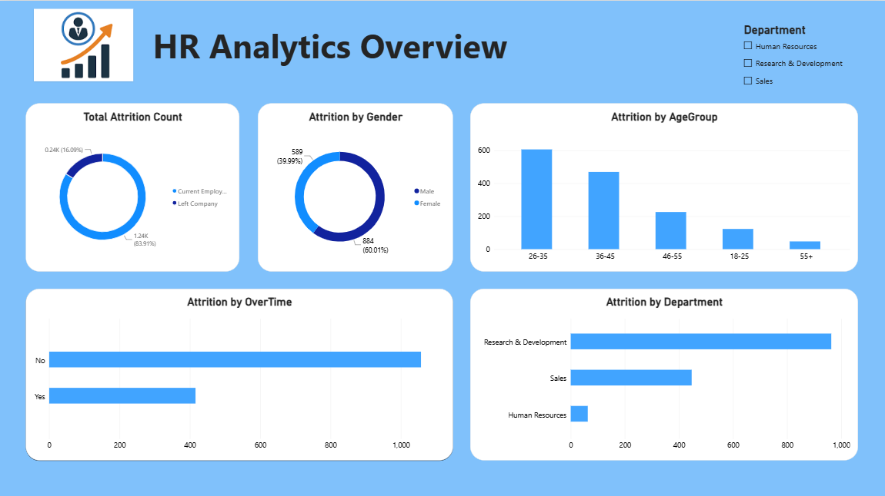

# 📊 HR Analytics Power BI Dashboard

An interactive Power BI dashboard and data analysis project analyzing employee attrition, workforce demographics, and key HR metrics to help organizations improve employee retention strategies.

---

## 📌 Project Overview
Employee attrition is a critical challenge for HR management. This project analyzes workforce data across **1,480 employees** to identify key risk factors driving employee turnover and deliver actionable insights for management.

---

## 🔑 Key Metrics (KPIs)

| Metric | Value |
| :--- | :--- |
| **Total Employees** | 1,480 |
| **Total Attrition** | 238 |
| **Attrition Rate** | **16.08%** |
| **Average Age** | 37 Years |
| **Average Monthly Income** | $6,505 |
| **Average Tenure at Company** | 7 Years |

---

## 💡 Key Insights & Findings

* **Overtime Impact**: Employees working overtime experience a **30.6% attrition rate**, compared to **10.3%** for non-overtime employees. Overtime is the strongest single predictor of turnover.
* **Age Group Distribution**: The **18–25 age group** shows the highest attrition rate at **35.8%**, followed by **26–35** at **19.0%**.
* **Departmental Dynamics**: 
  * **Sales**: Highest department turnover at **20.67%**.
  * **Human Resources**: Attrition rate at **19.05%**.
  * **Research & Development**: Lowest turnover at **13.75%**.
* **Gender Breakdown**: Male turnover stands at **16.98%** vs. **14.72%** for females.

---

## 🛠️ Tools & Technologies
* **Power BI**: Interactive Data Visualization & Dashboard Design
* **Power Query**: Data Cleaning, Transformation & Data Modeling
* **DAX**: Key Measure & Calculated Column Development

---

## 📸 Dashboard Preview



---

## 📁 Repository Structure
```text
├── HR_Analytics.pbix           # Interactive Power BI Dashboard
├── HR_Analytics.csv            # Dataset used for analysis
├── HR_Analytics_Dashboard.png  # Dashboard Screenshot
└── README.md                   # Project Documentation
